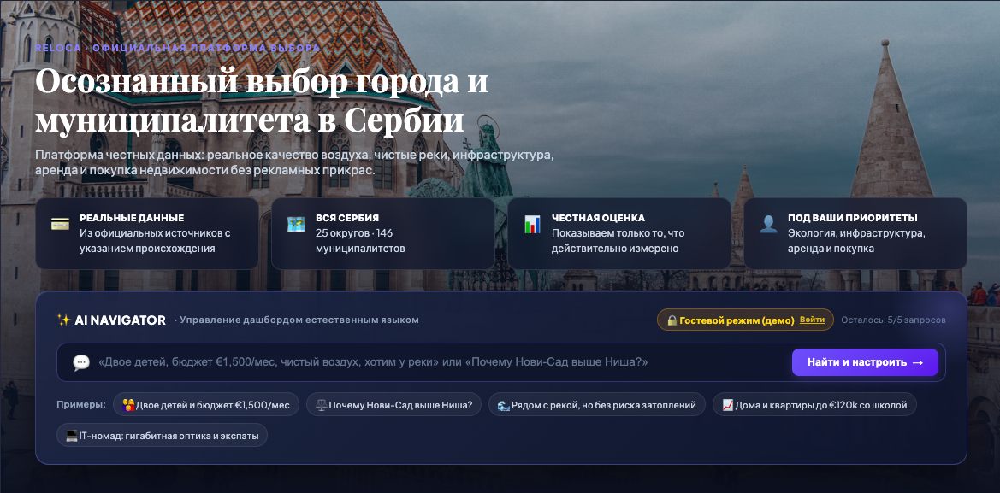

# RELOCA — платформа выбора города и общины в Сербии

**Работающий проект:** [reloca.site](https://reloca.site)

Платформа поддержки решений при релокации, покупке и аренде недвижимости в Сербии. Показывает только то, что действительно измерено: у каждого значения есть происхождение, а где данных нет, так и написано.

> Исходный код закрытый. Здесь описание проекта.

## Что внутри

- **25 округов и 146 общин** на одной карте и в алфавитном каталоге.
- **Экологический паспорт:** PM2.5 по данным станций SEPA, отопительный сезон, ветер Кошава и риск температурной инверсии.
- **Природный профиль:** реки, озёра, возможности для рыбалки.
- **Сравнение** семи ключевых центров (Белград, Нови-Сад, Ниш, Крагуевац, Суботица, Сомбор, Златибор).
- **«Ваше решение»:** 6 сценариев взвешенного выбора (релокация, удалёнка, экология, семья, быт, бюджет).
- **AI Navigator:** запрос обычным языком («двое детей, бюджет €1500, чистый воздух, у реки») настраивает подбор.
- **Практический гид релоканта:** проверенные ссылки на банки, интернет-провайдеров, госреестры, образование и медицину.
- **RU / EN** интерфейс.
- **Персональное PDF-досье по городу** (заявка с сайта, оплата вручную).

## Принцип честных данных

Каждое значение помечено происхождением: `REAL` (официальные измерения), `REFERENCE` (кадастровая и административная география), `DERIVED` (вычислено), `DEMO` (условные ориентиры), `UNKNOWN` (данных нет, цифра не придумывается).

## Стек

Монорепозиторий (pnpm workspace), карта на MapLibre GL, развёртывание на Linux VDS за Nginx с HTTPS.

## Автор

Олег · [gonka.blog](https://gonka.blog) · textsmen@gmail.com
